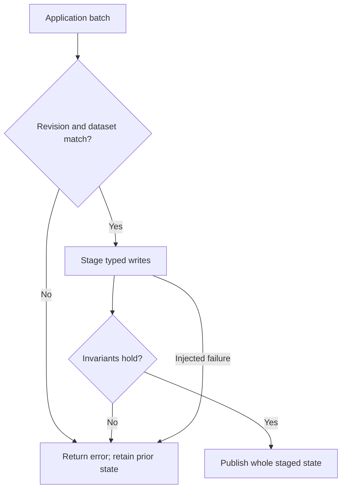

# Tempo Store

Typed persistence boundary for Tempo 2. The current implementation is an atomic
in-memory store. A future SQLite adapter implements the same `Store` trait.

## Public interface

`snapshot()` returns a consistent owned `Snapshot`. `commit(Commit)` accepts the
expected store revision, expected dataset identity and a batch of typed `Write`
values. It returns the new revision or an explicit unavailable, conflict or
invalid-operation error. The application owns batch composition; domain
components never receive a store, transaction or database handle.

Snapshots contain current content and learning, attempts, assessment history,
submission receipts, content history and all previously used dataset identities.
Shared records retain their owning crates' types. Scheduler memory is stored
without interpreting the selected learning algorithm's representation.

## Implemented guarantees

- A failed batch publishes no partial content, progress, grade, learning or
  receipt changes. A global optimistic revision detects stale snapshots.
- Attempt issuance uses current content and the current miss revision.
  Progress preserves identity and issue facts, increments the response revision
  once and cannot replace an existing terminal assessment.
- Terminal attempts have exactly one matching human assessment. Active attempts
  have prompts; closed attempts do not. A successful terminal assessment requires
  completed presentation.
- Newly committed assessments identify current content, agree with their source
  identities and match the learning state committed in that batch. The minimal
  contract supports at most one new assessment per target per batch.
- New receipts reproduce the committed attempt and assessment effect, or match
  an exact already committed historical result. Historical receipts retain old
  revisions and remain available after content changes and restore.
- Learning keys exactly match the current catalog. Content semantic changes
  require a newer content version; ordinary import cannot silently delete content.
- Restore requires a never-used dataset identity, including when earlier
  datasets had empty catalogs. Old attempts, receipts and history remain available.

`MemoryStore::fail_next_commit()` injects a failure after staging and validation
but before publication. It exists to prove the application's transaction and
retry behavior without requiring a database.

## Boundary and replacement work

The application checks command meaning, receipt replay order, current attempt
eligibility, policy compatibility and content-change semantics. Study owns
progression; Learning computes learning transitions; Chess validates content.
Store enforces persistence consistency and supplies atomic commit mechanics.

The in-memory adapter is process-local and provides **no disk durability**.
SQLite schema, unique/foreign-key constraints, migrations, crash recovery and
actual database transactions remain to be implemented and independently tested.
An SQL adapter must pass the same contract tests and add database-specific
durability/constraint tests; the memory tests do not establish those guarantees.

Run `cargo test -p tempo-store` from the development workspace. Tests cover
rollback, stale revisions, duplicate assessments, missing learning writes,
mismatched receipts, invalid issuance, external-source identity and reuse of an
empty historical dataset ID.
